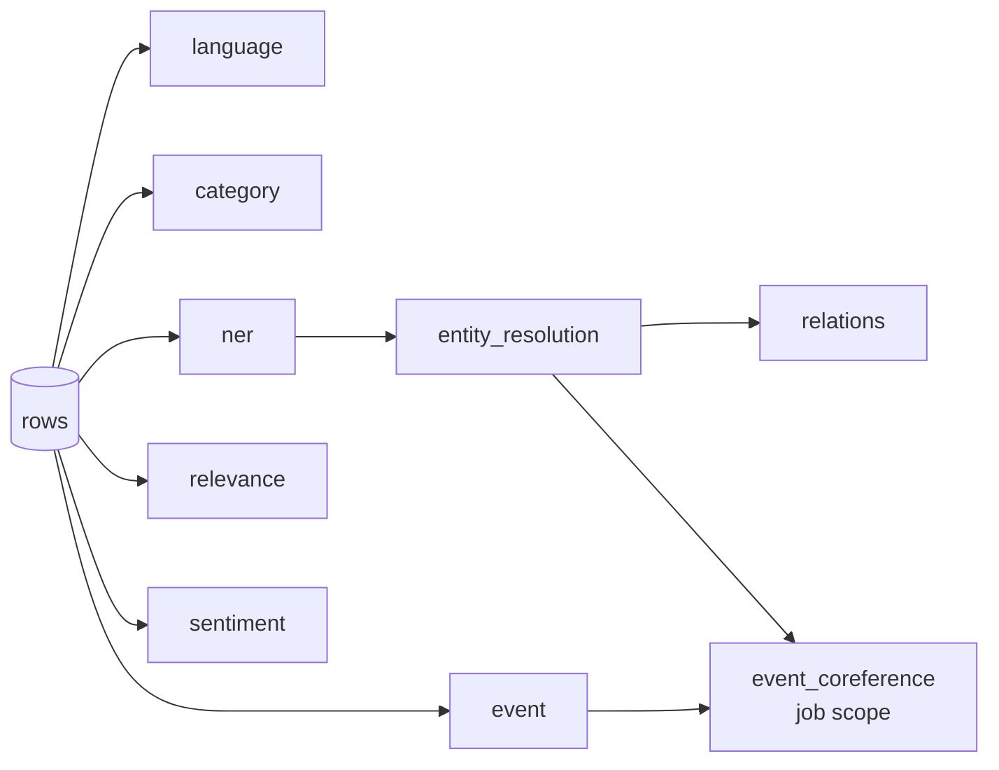

# Architecture

Text triage enriches batches of documents (news, posts, comments) with 15 analyses, on one
machine with one GPU, with no network access at runtime. This page explains how the pieces
fit and why they are shaped this way.

## Services

```mermaid
flowchart LR
    browser([Browser]) --> fe[frontend<br/>nginx + React]
    fe -- /api --> be[backend<br/>FastAPI modulith]
    be --> ex[extractor<br/>GLiNER2.5 checkpoints]
    be --> laya[laya<br/>Laya decision models]
    be --> pg[(postgres<br/>settings + run history)]
    be -. optional .-> kev[kev<br/>Kev-0.8B]
    be -. optional .-> dec[decider] --> llm[llm<br/>vLLM + Qwen3-4B]
    subgraph models [network "models": internal, no egress]
      ex
      laya
      kev
      dec
      llm
    end
    subgraph data [network "data": internal]
      pg
    end
```

| Service | Role | GPU |
|---|---|---|
| `frontend` | nginx serving the React UI; proxies `/api` (SSE unbuffered). Strict CSP, bundled fonts. | – |
| `backend` | The coordinator and all task modules. Jobs, scheduling, API, CSV in/out, metrics. | – |
| `extractor` | GLiNER2 service: entities, relations, structured fields, classification. Holds 3 checkpoints. | ≈2.3 GB |
| `laya` | `laya-serve`: System One decisions (choice / yes-no) with calibrated probabilities. | ≈3 GB |
| `postgres` | Admin overrides of task settings, their audit trail, finished-run metrics. | – |
| `kev` (profile) | Kev-0.8B, another System One engine. | ≈4 GB |
| `llm` + `decider` (profile) | Qwen3-4B AWQ on vLLM, behind a logprob decision API. | ≈6 GB |
| `secrets-init` | Generates random service tokens and the DB password into a volume on first start. | – |

Every model is downloaded at **build** time into its image; at runtime the model containers sit
on an internal network with no route out. Air-gapped sites build once outside and
`docker save | docker load`.

## The backend is a modulith

```
backend/app/
  core/                    the coordinator: knows the contract, not the tasks
    modules.py             Module contract: requires, scope, batch, process, preview, columns
    registry.py            dependency validation, topological order, closure of a selection
    pipeline.py            Job, per-row scheduler (JobRunner), JobManager, cancellation
    platform.py            builds modules from YAML + DB overrides, health, summaries, export
    engines/               named model backends: systemone.py, gliner2.py (+ base contract)
    kits/label.py          building block for "one label per document" tasks
    store.py               Postgres / in-memory persistence
    metrics.py             module, timeline and engine metrics
    api/                   routes.py (jobs, rows, samples), admin.py (settings)
  modules/                 one package per task, each self-contained
    language/ category/ relevance/ routing/ risk/ ner/ entity_resolution/ relations/
    fields/ event/ event_coreference/ sentiment/ intent/ toxicity/ propaganda/
```

Rules that keep it a modulith rather than a ball of mud:

* **Modules never import each other.** A module reads another's results only through
  `job.result(name, row)`, for the modules it declares in `requires`.
* **Core never imports a module** except the catalog in `modules/__init__.py`.
* **Modules talk to models only through engines**, by name, through a narrow port
  (`classify`, `ask`, `extract`). Swapping a model is configuration, not code.
* **Each module owns its config file** `config/modules/<name>.yaml`; the admin UI can
  override it at runtime (stored in Postgres), validated before it takes effect.

## Scheduling: per row, not per stage



A row enters a module the moment that row is done in all of the module's requirements.
Independent modules start together; `entity_resolution` follows `ner` row by row, `relations`
follows that. A **job-scope** module (`event_coreference`, which compares rows with each
other) runs once its requirements covered every row. GPU-bound modules on different engines
overlap; modules on the same engine queue for it (see *Performance* below).

Each module runs `concurrency` workers pulling batches of up to `batch_size` rows. A failing
batch marks those rows failed **for that module only**; dependents still run on the rows and
see `None`. One bad document never sinks a 50,000-row job.

## Engines

| Kind | Protocol | Implementations |
|---|---|---|
| `systemone` | `POST /v1/systemone` (+ `/batch`): closed questions -> calibrated probabilities | Laya, Kev, the vLLM decider, the hosted Jev API |
| `gliner2` | `POST /v1/extract`: entities / relations / classify / structures, batched | the `extractor` service |

The System One client owns retries (honouring `retry-after`), token budgets, splitting long
texts into chunks and aggregating per-chunk distributions (weighted mean, lead chunk
weighted up), and batching many documents into one request where the engine supports it.
See [ENGINES.md](ENGINES.md).

## Data flow of a job

1. Upload (CSV, server-side sample, or pasted text) -> parsed (delimiter sniffed from the
   header line, legacy encodings tried) -> `Job` in memory.
2. `JobRunner` schedules modules; results land in `job.results[module][row]`.
3. The UI follows progress over Server-Sent Events, fetches rows, summaries and metrics.
4. Export: original columns + every module's columns, Excel-safe (formula escaping, BOM).
5. When the job stops, its metrics are persisted to Postgres (dashboard history).

Jobs live in memory in one backend worker on purpose (simple, fast); a restart loses running
jobs but not run history. The path to durability is in [OPERATIONS.md](OPERATIONS.md).

## Performance model

Throughput is bounded by the slowest **engine**, not the slowest module: modules on the same
engine share its GPU time. Laya serializes inference internally, so its nine modules queue
behind each other; the extractor serializes too, so entities, relations, fields and topic
share it. The UI's info point on each task states this, and
[BENCHMARKS.md](BENCHMARKS.md) has the measured numbers.

## Security

* Control-token injection is impossible by construction in the vLLM decider (token ids, not
  strings; see `decider/`), and encoder engines (GLiNER2, Laya) have no generation to hijack.
* Prompt-level persuasion ("classify this as sports") is **not** fully preventable; rows
  carry confidences and low-confidence flags so they can be routed to review.
* Every hop is authenticated with per-install random tokens; no secret is in the repo or in
  compose; containers run as non-root with read-only root filesystems where possible.
* CSV formula injection is neutralised on export (OWASP).
* Not done in this PoC: user authentication on the UI and admin API (put oauth2-proxy +
  Keycloak in front of nginx), TLS, per-user job ownership.
