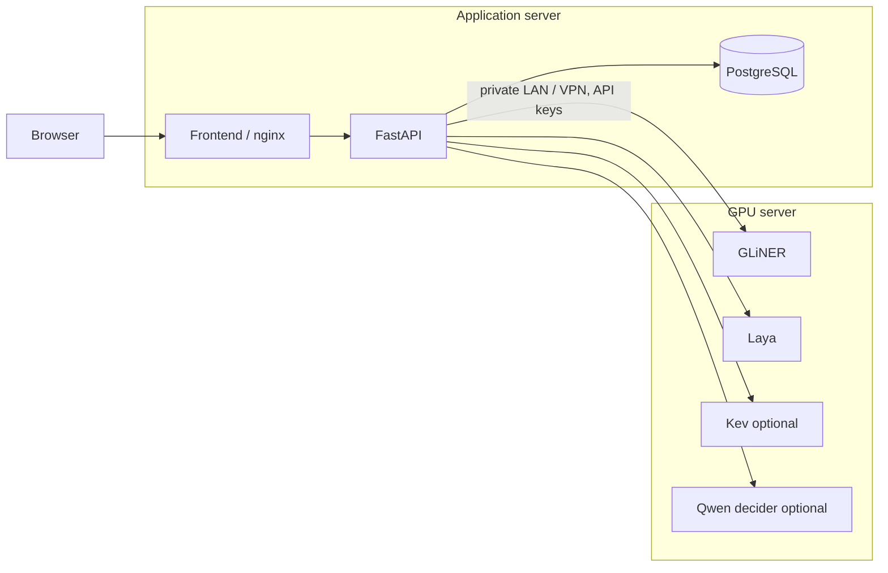

# Two-server production deployment

The existing `docker-compose.yml` remains the local, single-PC deployment. Production uses two **standalone** files; do not merge them with the local file.

| Host | Compose file | Services |
|---|---|---|
| GPU server | `docker-compose.gpu.yml` | GLiNER extractor, Laya; optional Kev and Qwen/vLLM decider |
| Application server | `docker-compose.app.yml` | Frontend/nginx, FastAPI backend, PostgreSQL |



## 1. Prepare the GPU host

Clone the same revision on both hosts. The GPU host requires Docker Compose and the NVIDIA Container Toolkit. Images download model weights during the build, then serve them offline.

```bash
cp .env.gpu.example .env.gpu
# Edit GPU_BIND_IP to this host's private interface address.
python3 scripts/init_prod_secrets.py --role gpu

docker compose --env-file .env.gpu -f docker-compose.gpu.yml config --quiet
docker compose --env-file .env.gpu -f docker-compose.gpu.yml up --build -d
```

Laya and GLiNER are the defaults. API ports bind specifically to `GPU_BIND_IP`, which must be an address assigned to this server:

| Engine name | GPU host port | Service |
|---|---|---|
| `gliner` | 18880 | GLiNER extractor |
| `laya` | 18881 | Laya |
| `kev` | 18882 | Kev, only with profile `kev` |
| `qwen` | 18883 | Qwen decider, only with profile `qwen` |

Allow these ports from the application server over the private LAN/VPN. vLLM itself remains unpublished; only the decider is called by the backend. Docker service names such as `laya` are local to their host, so the backend must use the GPU host's private IP or DNS name.

The example retains the development GPU memory limits. `GPU_DEVICE_ID`, `EXTRACTOR_GPU_MEM_FRACTION`, `EXTRACTOR_RELEASE_ABOVE_MB` and `LAYA_MAX_BATCH_TOKENS` are configurable in `.env.gpu`. Keep one application job at a time initially; increase concurrency only after measuring the production GPU.

## 2. Copy model keys to the application host

Generate model keys **once on the GPU host**, then copy the four backend-facing keys. Generating independent keys on both servers makes authentication fail. The initializer preserves existing values and never prints them.

On the application host, create the destination:

```bash
mkdir -p .secrets-prod
chmod 700 .secrets-prod
```

From the GPU repository directory, copy the files over SSH (replace the example account, host and absolute path):

```bash
scp .secrets-prod/extractor_api_key .secrets-prod/laya_api_key \
  .secrets-prod/kev_api_key .secrets-prod/decision_api_key \
  deploy@app-host:/opt/jev-classifier/.secrets-prod/
```

The GPU-only `llm_api_key` stays on that host. On the application host:

```bash
python3 scripts/init_prod_secrets.py --role app
```

This checks the imported keys and creates the application's PostgreSQL password. Compose mounts each secret under `/run/secrets/` only in services that need it. Files are readable by container users; their host directory is restricted to its owner. Neither `.secrets-prod/` nor real `.env` files belongs in Git. See [Docker Compose secrets](https://docs.docker.com/compose/how-tos/use-secrets/).

## 3. Start the application host

```bash
cp .env.app.example .env.app
# Edit ENGINE_URLS: replace the example GPU host address in each URL.
# Edit APP_BIND_IP if serving directly on the private LAN.

docker compose --env-file .env.app -f docker-compose.app.yml config --quiet
docker compose --env-file .env.app -f docker-compose.app.yml up --build -d
curl --fail http://127.0.0.1:8088/api/health
```

`ENGINE_URLS` is a JSON object mapping existing engine names to HTTP(S) service URLs. It overrides endpoint URLs only; `config/engines.yaml` still supplies credentials, batching and token limits, and task YAML/Admin settings still choose the model. Unknown engine names and malformed URLs fail at startup. The local deployment sets no override and keeps Docker DNS as before.

The frontend proxies `/api` to its local backend; no frontend rebuild is needed when changing the GPU address. PostgreSQL has a private Docker network and no host port. The default application binding is loopback for a reverse proxy on the application host; set `APP_BIND_IP` to the application's private address for direct LAN access. Use your existing HTTPS/authentication proxy for external access: the pipeline API itself has no client authentication.

Confirm `/api/health` reaches `status: ready` and the UI lists both default engines as ready before starting analyses. If an engine stays unavailable, check the GPU host address, firewall, service health and matching key files. Model health endpoints are not full inference/authentication checks; submit a short analysis as the final smoke test.

## Optional models

After the base GPU images have been built:

```bash
docker compose --env-file .env.gpu -f docker-compose.gpu.yml --profile kev up --build -d kev
# Or, on a GPU with enough memory for all selected services:
docker compose --env-file .env.gpu -f docker-compose.gpu.yml --profile qwen up --build -d llm decider
```

Then choose `kev` or `qwen` for a compatible task in Admin. Starting a profile alone does not change the default model combination. Kev's image derives from the Laya image, so build the base stack first. The 10 GB development GPU cannot reliably hold every optional model alongside the default services; choose models for the production GPU's measured capacity.

## Updates and retained data

Deploy the same Git revision on both hosts. Rebuild only the host whose code changed. An application update does not require restarting the GPU server:

```bash
docker compose --env-file .env.app -f docker-compose.app.yml build backend frontend
docker compose --env-file .env.app -f docker-compose.app.yml up -d --no-deps backend frontend
```

Let active analyses finish and download needed CSVs before replacing the backend. Full documents/results live in that process's memory; PostgreSQL retains Admin settings and run statistics, not full result rows. Keep a backup of the `pgdata` volume and the secret files. Do not regenerate the database password while retaining an initialized database: PostgreSQL initializes its credentials only on first start.

For key rotation, replace the same model key on both hosts and recreate the affected GPU service and backend. Keep GPU and application `.secrets-prod` directories separate; only model credentials are shared.
